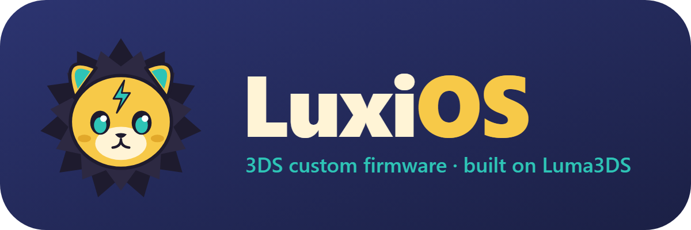

# LuxiOS

*A fork of [Luma3DS](https://github.com/LumaTeam/Luma3DS) for the Nintendo 3DS family (Old and New 3DS/2DS), with bug fixes and a new look.*

> [!WARNING]
> **Not yet tested on real hardware.** Every change here builds cleanly with devkitARM, and the formatter and config fixes pass host-side unit tests. Nobody has booted this build on a console yet. Keep a known-good `boot.firm` from upstream Luma3DS on hand. Luma3DS itself can't brick a console, since boot9strap keeps loading `boot.firm` from the SD card and you can swap it back on a PC.

> [!NOTE]
> **AI-assisted.** The code changes, artwork and this README were written with an AI coding assistant (Claude). Each commit says what changed and why.

## What's different from Luma3DS

**Bug fixes**
- **Loader / 3DSX homebrew:** checks the 3DSX segment-size sum for integer overflow; the reloc count is now unsigned (a huge count used to overflow the reloc buffer); skipped reloc tables are measured in bytes, not entries; `bssSize > dataSegSize` is rejected.
- **hb:ldr:** the SetTarget/SetArgv size clamps used `max` instead of `min`, so SetTarget could overflow the 256-unit path buffer.
- **Sysmodule CXI override:** reads a fixed-size ExHeader instead of a size taken from the file.
- **Cheats:** handle more than 255 cheats (the counter used to wrap); line indexes past 255 no longer cause infinite loops; type-E codes are bounds-checked; very long lines are always terminated.
- **Plugin loader (3GX):** checks header, author, title and target sizes against the file and memory block; rejects truncated headers; bounds the error message; always terminates the `user_param.bin` path; empty plugin menus no longer index out of bounds.
- **GDB stub:** rejects overlong host-I/O paths before decoding them into a stack buffer.
- **config.ini:** written with a new bounded `snprintf` instead of sprintf-then-check (this was the old FIXME). Floats are saved correctly: `1.10000001` used to become `1.01`, and brightness `-0.5` used to become `0.5`. Negative values are read correctly: `-1.5` used to load as `+0.5` and `-1` as `+1`. Saving from the boot config menu no longer wipes settings the menu doesn't show. Menu combo strings no longer overflow 128-byte buffers.
- **Sleep / standby:** if the power-management service was briefly unavailable, Rosalina lost every later sleep acknowledgement, so the console could get stuck in standby (plausibly upstream [#2258](https://github.com/LumaTeam/Luma3DS/issues/2258)). It now retries and never leaves the service in a broken state.
- **Menu stability:** a message box opened while the menu was up un-froze the game too early; *Power off* kept drawing over the game's screen and could leave the menu broken until reboot; the process list overflowed a buffer after ~100 s of uptime (on all non-release builds).
- **Plugins:** an always-true condition in the kernel's APT hook sent plugins false "HOME menu" events, desyncing plugin state (plausibly upstream [#2254](https://github.com/LumaTeam/Luma3DS/issues/2254), System Settings crashing with a plugin loaded).
- **Kernel extension:** a NULL dereference when asking for the owner of an ownerless object; a session table that stopped removing entries once full (dangling pointers); a handle-list call that could overrun Rosalina's buffer (now takes an optional limit, still compatible with existing homebrew).
- **GDB debugger:** a memory-read request could overflow a stack buffer by up to 2 GB; IO memory access used wrong offsets; memory search used the wrong data; packets could overrun the receive buffer by 2 bytes; watchpoints leaked a lock (later hang), removed the wrong slot, and weren't all cleared on detach.
- **Screenshots:** when memory was low (common on Old 3DS, or with 3D/800px top screens), screenshots were saved in chunks and every chunk after the first was written past its buffer in kernel mode, which could crash the console or save garbage.
- **Rebooting into DS/GBA games or System Settings** could crash the process manager if an optional calibration value couldn't be read (possible on models without the New 3DS face-tracking camera).
- **Menu combo:** closing the lid while changing it set the combo to "nothing", so the menu reopened nonstop until reboot.
- **Wi-Fi:** "Disable forced wireless connection" couldn't actually release a forced connection; 32-character network names could garble the slot list.
- **Time zones:** offsets like UTC−03:30 were shown as −04:30, and choosing "−03:30" applied −02:30.
- **Screen filters:** *Invert* also inverted color temperature, contrast and gamma (invert + warm gave plain white instead of warm white).
- **Plugins:** plugin memory could contain leftover data from other programs (only a quarter of each block was cleared).
- **Memory dumps of big games** (Process list → dump) crashed; they're now written in pieces with a progress counter (upstream [#1398](https://github.com/LumaTeam/Luma3DS/issues/1398)).
- **Region emulation broke system-version checks** (e.g. NetPass): apps looked for the version file of the *emulated* region, which doesn't exist. Those lookups now go to your console's real region (upstream [#2141](https://github.com/LumaTeam/Luma3DS/issues/2141)).
- **Game cards with the NoCrypto flag** failed to load. Includes the community fix from upstream PR [#1829](https://github.com/LumaTeam/Luma3DS/pull/1829), hardened so that if it doesn't recognize your system's code it simply skips itself instead of stopping the boot (upstream [#1827](https://github.com/LumaTeam/Luma3DS/issues/1827)).
- **Card slot power menu** showed "DISABLED" for any error and ignored failed toggles. It now shows whether a card is detected, the real error code, and toggle failures, so a dirty slot isn't mistaken for a stuck setting (upstream [#2227](https://github.com/LumaTeam/Luma3DS/issues/2227)).
- **Cheats that fail now say why:** when a cheat turns red, the *Cheat list* title line shows the failed access (R/W), address, error code, and the memory's state and permissions. This is to pin down upstream [#2163](https://github.com/LumaTeam/Luma3DS/issues/2163) (offset codes that work in CTRPF but not here), whose cause couldn't be found without the game.
- **Shutdown:** Rosalina's service loop could spin forever during cleanup if an unsubscribe failed.
- **Network time (NTP):** no longer freezes the console if the time server's reply is lost (likely upstream #2195); the synced clock is no longer up to 1 s fast; times after 2036 are handled.
- **Community fixes merged from open upstream pull requests:** Local Play and StreetPass work again after Rosalina's networking was used ([#2262](https://github.com/LumaTeam/Luma3DS/pull/2262)), and opening the menu no longer freezes some games while the GPU is busy ([#2232](https://github.com/LumaTeam/Luma3DS/pull/2232), with a time limit added to its wait loop).

**New features**
- **Peek at the game:** hold <kbd>Y</kbd> in the LuxiOS menu to see the game's bottom screen; let go to return. The game stays paused. (Requested upstream in [#2224](https://github.com/LumaTeam/Luma3DS/issues/2224).)
- **Always-on cheats:** start a cheat's name with `*` in your cheats file (for example `[*60 FPS]`) and it turns on by itself when the game starts, with no need to open the menu. You can still switch it off in *Cheats*. (Requested upstream in [#1619](https://github.com/LumaTeam/Luma3DS/issues/1619).)
- **Close a frozen game or app:** in *Process list*, select it and press <kbd>X</kbd>, then <kbd>X</kbd> again to confirm. Only games and homebrew can be closed this way, never system processes. (Requested upstream in [#2134](https://github.com/LumaTeam/Luma3DS/issues/2134).)
- **Choose the time server:** put an IPv4 address (like `192.168.1.1`) in `/luma/ntp_server.txt` to sync the clock from that server instead of time.windows.com. (Requested upstream in [#1969](https://github.com/LumaTeam/Luma3DS/issues/1969).)
- **Screenshots sorted per game:** saved to `/luma/screenshots/<TitleID>/` (requested upstream in [#1627](https://github.com/LumaTeam/Luma3DS/issues/1627)).
- **Pick which game update loads:** put a 2-byte little-endian `remaster.bin` in `/luma/titles/<TitleID>/` (with game patching on) to force a specific update version. Useful when mods target one version. Based on upstream PR [#2170](https://github.com/LumaTeam/Luma3DS/pull/2170).
- **Kept up to date with Luma3DS:** includes upstream's late-October 2026 work: audio routing and stereo volume balance, LED brightness override, date and time in the menu, per-channel screen filters, UPS patches and much faster IPS patches.

**Look and feel**
- LuxiOS name in the boot config menu, chainloader, the in-game menu (formerly "Rosalina menu"), and the credits.
- Gold menu titles, and **Luxi**, the mascot, on the credits screen.
- Optional boot splash: copy `splash.bin` and `splashbottom.bin` from a release to `/luma/` on your SD card, then turn on *Splash* in the config menu.

**Kept compatible:** the `/luma/` folder, `config.ini` format, service names and the `svcGetSystemInfo` interface are unchanged, so homebrew and existing settings keep working.

## Luxi

Luxi is an original electric lion cub made for this project: gold face, lightning-burst mane, teal eyes and a bolt on the forehead. Sources are in `branding/` (SVG) and are generated by `luxios-tools/make_logo.py`. Luxi is not affiliated with Nintendo, Game Freak or The Pokémon Company.

## Building

Same as [Luma3DS](https://github.com/LumaTeam/Luma3DS#building-from-source): install devkitARM + libctru (the `3ds-dev` package via dkp-pacman), [makerom](https://github.com/3DSGuy/Project_CTR) and [firmtool](https://github.com/TuxSH/firmtool), then run `make` to get `boot.firm`. Host tests (any clang/gcc): `luxios-tools/tests/run_fmt_test.sh`, `run_float_test.sh`, `run_date_test.sh` and `run_ntp_ip_test.sh`.

## Credits and license

LuxiOS is GPLv3, like Luma3DS. All credit for Luma3DS goes to **LumaTeam** and its contributors; the in-game credits screen keeps their notice. LuxiOS is not affiliated with or endorsed by LumaTeam or Nintendo.

## Basic usage

These work the same as in Luma3DS:

- **Config menu:** hold <kbd>Select</kbd> while powering on. Settings live in `/luma/config.ini` on the SD card.
- **Chainloader:** hold <kbd>Start</kbd> while powering on. Payloads go in `/luma/payloads/*.firm`.
- **LuxiOS menu (formerly the Rosalina menu):** press <kbd>L</kbd>+<kbd>Down</kbd>+<kbd>Select</kbd> in game or on the HOME Menu. Use *Save settings* to keep changes.

## Based on Luma3DS

LuxiOS is built on [Luma3DS](https://github.com/LumaTeam/Luma3DS) by LumaTeam. For the full feature list, components and documentation, see the [upstream README](https://github.com/LumaTeam/Luma3DS#readme) and [wiki](https://github.com/LumaTeam/Luma3DS/wiki). Source files keep their original Luma3DS copyright headers, as GPLv3 requires. Files changed for LuxiOS carry a "Modified for LuxiOS" line, and the git history shows every change.

The upstream licensing and credits sections are reproduced below unchanged.

## Licensing
This software is licensed under the terms of the GPLv3. You can find a copy of the license in the LICENSE.txt file.

Files in the GDB stub are instead triple-licensed as MIT or "GPLv2 or any later version", in which case it's specified in the file header. PM, SM, PXI reimplementations are also licensed under MIT.

## Credits

Luma3DS would not be what it is without the contributions and constructive feedback of many. We would like to thanks in particular:

* **[@devkitPro](https://github.com/devkitPro)** (especially **[@fincs](https://github.com/fincs)**, **[@WinterMute](https://github.com/WinterMute)** and **[@mtheall](https://github.com/mtheall)**) for providing quality and easy-to-use toolchains with bleeding-edge GCC, and for their continued technical advice
* **[@Nanquitas](https://github.com/Nanquitas)** for the initial version of the game plugin loader code as well as very useful contributions to the GDB stub
* **[@piepie62](https://github.com/piepie62)** for the current implementation of the Rosalina cheat engine, **Duckbill** for its original implementation
* **[@panicbit](https://github.com/panicbit)** for the original implementation of screen filters in Rosalina
* **[@jasondellaluce](https://github.com/jasondellaluce)** for LayeredFS
* **[@LiquidFenrir](https://github.com/LiquidFenrir)** for the memory viewer inside Rosalina's "Process List"
* **ChaN** for [FatFs](http://elm-chan.org/fsw/ff/00index_e.html)
* Everyone who has contributed to the Luma3DS repository
* Everyone who has assisted with troubleshooting end-users
* Everyone who has provided constructive feedback to Luma3DS
